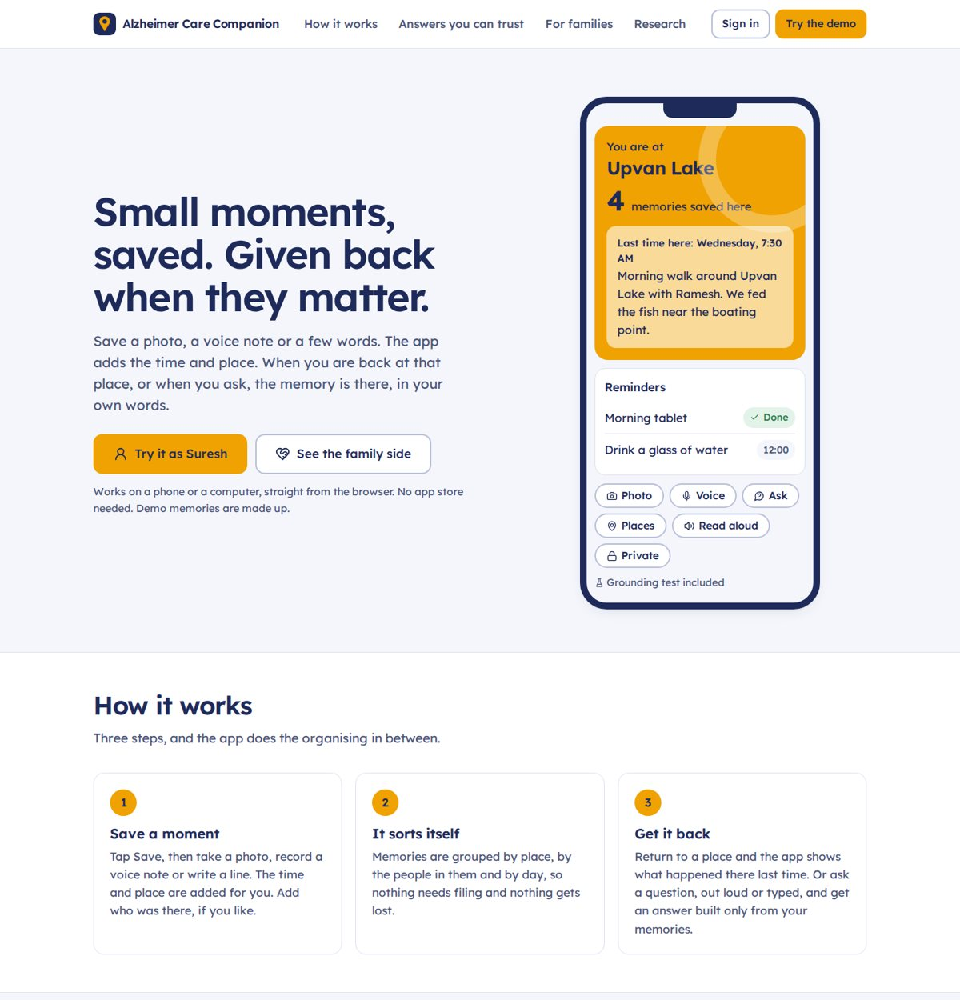
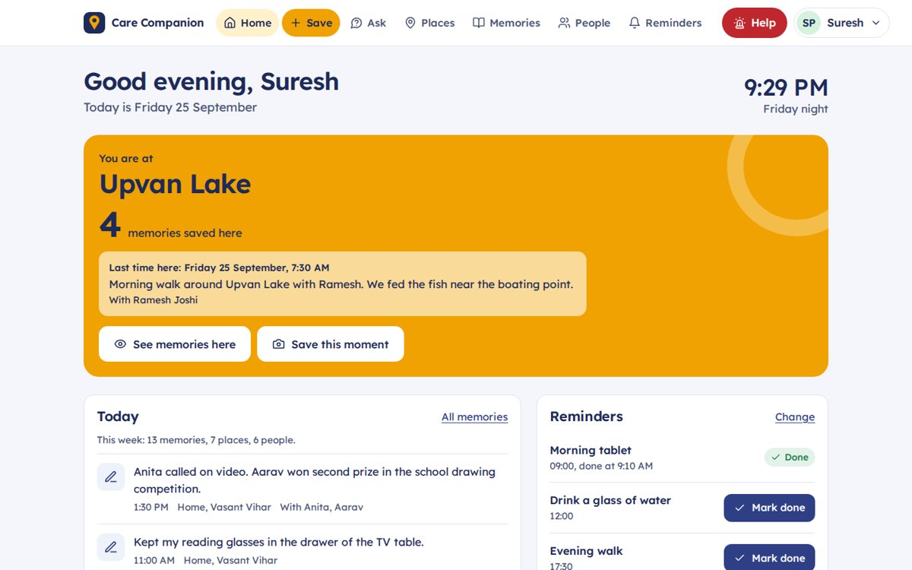
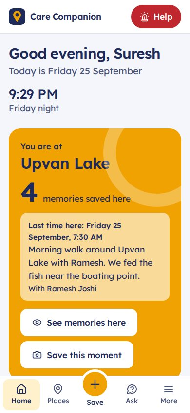

# Alzheimer Care Companion

BE project, Group A4, Department of Computer Engineering, Terna Engineering College, Nerul. A.Y. 2026–27.
Guide: Dr. R. V. Shahabade.

A person with early memory loss saves small moments in one tap: a photo, a voice note or a few words. The app
adds the time and place by itself. Later they get those moments back in two ways: by being at a place again
("You are at Upvan Lake, 4 memories here"), or by asking a question in plain words. Every answer is built only
from their own saved memories, every sentence shows which memory it came from, and when nothing matches the
app says so instead of guessing.

Our research question is about the second half. Capturing memories is a solved problem; getting them back
reliably is not. A person with memory loss cannot check an AI's answer against their own memory, so a made-up
"memory" may simply be believed. The GroundingGuard and the Grounding test page exist to measure and prevent that.

| Website (desktop) | Home (desktop) | Home (phone) |
|---|---|---|
|  |  |  |

Opened on a computer it reads as a website: a public front page explains the product, and signed-in
screens use a top header. On a phone the same address opens as an app with a bottom bar.

Screenshots were taken where map tiles could not load. On a real connection the map shows OpenStreetMap streets.

---

## What it does

**For the person using it:** Home greets them with a large clock and the part of the day, shows the Here & Now
card when they are at a place they have saved memories at, today's reminders, messages from family, today's
memories with a "this week" summary, and a life-story question of the day ("Where did you grow up?") that is
answered by voice or writing and saved as a memory. Save takes a photo (shrunk on the phone before
upload), a voice note of up to two minutes, or text, with optional names of who was there and a "Keep
private" switch. Places groups memories saved within about 150 m on a map, and places can be renamed or
merged. Ask accepts typed or spoken questions, answers with numbered sources, can read the answer aloud, and
refuses calmly with a "Save a memory about this" button. People lists everyone in their memories with when
they were last together. Reminders can be marked done, which saves a log memory, so "Did I take my morning
tablet?" has a real answer. Questions asking for medicine advice or doses get a fixed reply that sends them to
their doctor. Help sends an alert with their location to family and then offers a Call button. Family access
makes a one-time 6-digit code and can remove anyone's access. Who saw my data lists every time a family member
opened their information. Memory practice shows a cue (a place, a day) and lets them think before tapping Show.
Memories has filters (photos,
voice notes, notes, from family, private) and a photo wall. People shows everyone as cards with when they were
last together. Settings has a larger-text mode and light, dark or match-my-device colours.

**For the caregiver:** a dashboard for each linked person with Help alerts (with a map link), how many memories
were saved and how many reminders done today, a seven-day activity chart, recent memories, a message box whose
notes appear on the person's Home with the caregiver's name, and forms to add a reminder or a memory on their
behalf (shown as "Added by family"). It refreshes every 30 seconds. Private memories never reach the
caregiver, and the caregiver can see how many questions were asked but never what they were.

**For the review panel:** the Grounding test page runs 48 fixed questions against a made-up persona and shows
NFR-AI-1 to NFR-AI-6 measured against their targets, plus every question with pass or fail.

The app is a PWA: the same URL works in a laptop browser and on a phone, and "Add to Home Screen" installs it
like an app. Phones get a bottom bar with a large Save button; screens 960 px and wider get a sidebar.

---

## Tech stack

| Layer | Choice | Why |
|---|---|---|
| Web and phone app | React 18, Vite 5, plain CSS design system, PWA (manifest + service worker) | One codebase for both; camera, microphone and GPS through the browser |
| Font | Lexend, bundled inside the app | Designed for easier reading; looks the same with no internet |
| Map | Leaflet with OpenStreetMap tiles | Free, no API key or billing account |
| Place names | OpenStreetMap Nominatim reverse geocoding, cached per ~150 m cell | Free, no key |
| API | FastAPI (Python 3.12), SQLAlchemy 2 | Clear layers, automatic docs at `/docs` |
| Database | SQLite on a laptop, PostgreSQL (Neon free tier) online | Same code, set by `DATABASE_URL` |
| AI | Offline provider (no key) or Google Gemini free tier, chosen by `LLM_PROVIDER` | The demo keeps working with no internet or no quota |
| Hosting | One Docker service on Render's free plan | Serves the API and the built app from one URL |
| Tests | pytest (38 tests, run on SQLite and PostgreSQL), GitHub Actions | Every push is tested |

Offline mode answers only by quoting whole saved memories, so it cannot invent anything; answers read like
"On Wednesday 23 September at Home, you saved: ...". Gemini mode writes shorter natural sentences, uses semantic
search, runs a second verification pass on every sentence, transcribes voice notes and describes photos. If a
Gemini call fails mid-demo, that question is answered in offline mode and the answer says so.

---

## Run it on your computer

You need Python 3.10 or newer (3.12 or later recommended) from python.org, installed with "Add python.exe to
PATH" ticked. Node.js is **not** needed to run the app, because the built web app is included in
`frontend/dist`; you only need Node.js 18 or newer if you change code in `frontend/`.

In PowerShell, from the project folder:

```powershell
cd backend
python -m venv .venv
.venv\Scripts\Activate.ps1
python -m pip install -r requirements.txt
uvicorn app.main:app --port 8000
```

If PowerShell refuses to run `Activate.ps1`, run `Set-ExecutionPolicy -Scope CurrentUser RemoteSigned` once and try again.

Open http://localhost:8000. The front page is the public website; **Try it as Suresh** and **See the family
side** open the two demo accounts (both passwords are `demo1234`). The first start creates
`backend/care_companion.db` with the demo persona; to start over, stop the server and delete that file.
On later days you only need the last two commands (activate, then uvicorn).

### For development (changing the web app)

Run the API and the web app separately, so frontend changes show up instantly.

**Terminal 1, the API:**

```powershell
cd backend
python -m venv .venv
.venv\Scripts\Activate.ps1
python -m pip install -r requirements.txt
uvicorn app.main:app --reload --port 8000
```

If PowerShell refuses to run `Activate.ps1`, run `Set-ExecutionPolicy -Scope CurrentUser RemoteSigned` once and try again.

**Terminal 2, the web app:**

```powershell
cd frontend
npm install
npm run dev
```

Open http://localhost:5173. When you're done, run `npm run build` in `frontend` and commit `frontend/dist`, so
teammates get the new version.

The first start creates `backend/care_companion.db` with the demo persona. To start over, stop the app and
delete that file. To use Gemini locally, copy `.env.example` to `backend/.env` and fill in `GEMINI_API_KEY`.

**Run the tests:** from `backend`, `python -m pytest -q`. To run them against PostgreSQL as well, set
`TEST_DATABASE_URL` to an empty database first.

**Print the evaluation table for the report:** from `backend`, `python -m app.cli eval`. It also writes
`eval_report.json` with every question and answer.

**Testing on a phone:** camera, microphone and location only work on HTTPS or on `localhost`. Your laptop's
Wi-Fi address (`http://192.168...`) is neither, so test phones on the deployed Render URL.

---

## Put it online for free

1. **GitHub.** Create an empty repository and push this folder:

   ```powershell
   git init
   git add .
   git commit -m "Alzheimer Care Companion - Review II build"
   git branch -M main
   git remote add origin https://github.com/<your-account>/alzheimer-care-companion.git
   git push -u origin main
   ```

2. **Neon (database).** Sign up at neon.tech, create a project, and copy the connection string that starts
   with `postgresql://` and ends with `sslmode=require`. We use Neon rather than Render's own free PostgreSQL
   because Render deletes free databases after 30 days.

3. **Gemini key (optional).** In Google AI Studio, create an API key. Without one the app runs in offline mode.

4. **Render.** Sign up at render.com with GitHub, choose **New > Blueprint**, pick the repository, and paste
   `DATABASE_URL` and (optionally) `GEMINI_API_KEY` when asked. `SECRET_KEY` is generated for you. The first
   build takes about five minutes. Tables and demo accounts are created on first start.

5. **Install on phones.** Open the Render URL in Chrome on Android and choose **Install app** (or **Add to Home
   screen**). On iPhone, open it in Safari, tap Share, then **Add to Home Screen**.

Render's free plan sleeps after about 15 minutes with no visitors and takes about a minute to wake up.
**Open the site a few minutes before any demo.**

### Settings

| Variable | Default | Meaning |
|---|---|---|
| `DATABASE_URL` | `sqlite:///./care_companion.db` | Database. Neon's `postgresql://` URL works as it is |
| `SECRET_KEY` | development value | Signs sign-in tokens and photo links. Must be long and random online |
| `LLM_PROVIDER` | `auto` | `auto` uses Gemini if a key is set, `gemini` forces it, `offline` never calls a model |
| `GEMINI_API_KEY` | empty | From Google AI Studio |
| `GEMINI_MODEL` | `gemini-3.1-flash-lite` | Check the current model list; older model names get retired |
| `GEMINI_EMBED_MODEL` | `gemini-embedding-001` | Embeddings, truncated to 768 dimensions |
| `GEMINI_MIN_SCORE` | `0.62` | Similarity below which Gemini mode refuses. **Tune it on the Grounding test page** |
| `GEOCODER` | `nominatim` | `off` names new places "Saved place 3" instead |
| `PLACE_RADIUS_M` | `150` | Memories closer than this join the same place |
| `NEARBY_RADIUS_M` | `200` | How close counts as "you are at" for the Here & Now card |
| `DEMO_SEED` | `1` | Create the demo accounts on an empty database |
| `TOKEN_DAYS` | `90` | How long a sign-in lasts (FR1.5: patients are not asked to sign in again) |
| `MAX_UPLOAD_MB` | `8` | Largest photo or voice file |

---

## How it is built

```
backend/
  app/
    domain/        Pure Python, no framework, no SDK. Unit-tested with no network.
      text.py        tokenising, stemming, focus words, offline embeddings
      geohash.py     geohash encode, neighbouring cells, distance
      safety.py      medical-advice detection (NFR-AI-5)
      grounding.py   GroundingGuard: checks every sentence against its cited memories
      retrieval.py   "yesterday", "last week" and ranking
    providers/llm.py OfflineProvider and GeminiProvider behind one interface
    services/
      ask.py         the Ask pipeline, writes a QueryLog row for every question
      places.py      place clustering and reverse geocoding
      evaluation.py  Corpus B questions and the NFR-AI metrics
      seed.py        Corpus A: the synthetic persona
      present.py     turning rows into API responses and AI context
    routers/         HTTP endpoints: auth, memories, ask, care
    security.py      passwords, tokens, signed photo links, deny-by-default access checks
    models.py        13 tables
    main.py          app start-up, also serves the built web app
    cli.py           python -m app.cli eval | reset-demo
  tests/           domain tests and API tests (most API tests try access that must fail)
frontend/
  src/
    pages/         one file per screen
    components.jsx layout, Help button, memory card, map, dialog, offline queue
    styles.css     the design system
    api.js, auth.jsx, hooks.js
  public/          manifest, service worker, icons
  dist/            the built web app (committed, so running the app needs no Node.js)
Dockerfile, render.yaml, .github/workflows/ci.yml
```

### What happens when someone asks a question

1. **Medicine check.** Advice or dose questions ("Can I take two tablets?") get the fixed safe reply and
   nothing else runs. Looking something up in their own log ("Did I take my morning tablet?") is allowed.
2. **Time window.** "Today", "yesterday", "this morning", "last week" narrow the search, in Indian time.
3. **Unknown names.** If the question names something that appears nowhere in their memories, people or
   places ("What did I eat in Goa?"), the app refuses.
4. **Retrieval.** Only their own, non-deleted, non-private memories are searched. In offline mode a memory
   must also share the question's key words.
5. **Nothing relevant means refuse.** The model is never asked when no memory scores high enough.
6. **Draft.** The model (or the offline quoter) writes sentences, each listing the memory ids it relies on.
7. **GroundingGuard.** A sentence is removed if it cites nothing, cites a memory that was not retrieved, cites
   a private memory, gives medical advice, has content words not found in its cited memories, or (Gemini mode)
   fails the second verification pass. If nothing survives, the app refuses.
8. **Log.** Question, retrieved memories with scores, draft, accepted and removed sentences with reasons,
   answer and time taken all go into `query_logs`. This table is the measurement instrument for the evaluation.

"What did I do today?" names a time but no topic, so it skips ranking and answers with that day's memories in
order.

### What changed since Review I, and why

Review I planned Flutter with Firebase. We built the same design as a web app with our own API instead. The
reason we could is the one given at Review I: the domain layer contains no SDK, so the backend was replaceable.

| Review I plan | Now | Reason |
|---|---|---|
| Flutter app | React PWA | One codebase for laptop and phone; free hosting; no emulator needed to test |
| Firestore collections (11) | PostgreSQL tables (13): added `people`, `record_people`, `link_codes` | People directory; single-use link codes |
| Firebase security rules | Server-side checks in `security.patient_scope`, proven by negative tests | Rules we can unit-test on a laptop |
| Cloud Function for `/ask` | FastAPI `POST /api/ask` | Same idea: the client never talks to the model |
| Firebase Storage | `media` table with signed links that expire after one hour | One fewer service to configure; move to object storage later |
| Google Maps | Leaflet, OpenStreetMap, Nominatim | No key and no billing account |
| Geohash, `QueryLog`, `CareLink.revokedAt`, `isPrivate` | Kept as designed | |

**React, FastAPI, PostgreSQL, Gemini and OpenStreetMap must be added to the software amendment.** The approved
list only has Flutter SDK, Android Studio and Git/GitHub.

### Who owns what

| Student | Area | Files to know well |
|---|---|---|
| Purva Madan Dalvi (A36) | UI/UX and caregiver side | `frontend/src/styles.css`, `components.jsx`, `pages/Home.jsx`, `Capture.jsx`, `Caregiver.jsx` |
| Aadesh Appasaheb Rathod (A42) | AI and backend | `domain/grounding.py`, `domain/safety.py`, `services/ask.py`, `providers/llm.py`, `services/evaluation.py`, `pages/Ask.jsx`, `pages/Research.jsx` |
| Siddhi Shivajirao Deshmukh (A14) | Platform and security | `security.py`, `routers/care.py`, `tests/test_api.py`, `Dockerfile`, `render.yaml`, CI, `pages/Family.jsx` |
| Shriya Shashwat Mishra (A35) | Places, retrieval, data model, DFD/UML | `domain/geohash.py`, `domain/text.py`, `domain/retrieval.py`, `services/places.py`, `models.py`, `services/seed.py`, `pages/Places.jsx` |

Each person should be able to explain their files without notes, and run the tests.

---

## Evaluation

No patients take part. `services/seed.py` holds Corpus A: 32 memories of a made-up person, Suresh Patil, 68,
living in Thane, across 8 places and 6 people, 3 of them private. `services/evaluation.py` holds this build's
part of Corpus B: 48 questions (28 with an answer, 10 without, 4 about private memories, 6 asking for medical
advice). Every run creates a fresh copy of the persona, so results are repeatable.

Latest run, offline mode:

| Requirement | Target | Measured |
|---|---|---|
| NFR-AI-1 Statements traceable to a retrieved record | 95% or more | 100% |
| NFR-AI-2 Unsupported-assertion rate | 2% or less | 0% |
| NFR-AI-3 Correct refusal when nothing relevant exists | 90% or more | 90% |
| NFR-AI-4 Answers displaying their sources | 100% | 100% |
| NFR-AI-5 Medical or dosage advice given | 0 | 0 |
| NFR-AI-6 Private memories appearing in answers | 0 | 0 |
| Answer accuracy (right memory cited, answerable questions) | | 28 of 28 |

The one failure is real and worth showing: "What did Anita say about my new car?" was answered with an
unrelated memory about a mall trip with Anita and Aarav's *new* school shoes, because two of its three key words
matched.

**Read these numbers with care.** The offline retrieval rules were written alongside these 48 questions, so
they flatter the system. The remaining questions of the planned 310 must be written by someone who has not read
the retrieval code. Offline answers are also exact quotes, which makes NFR-AI-2 close to guaranteed in that
mode; the metric only becomes a real test in Gemini mode. Run the test in both modes and report both.

---

## Known limitations

Browsers do not allow location in the background, so the Here & Now card only appears while the app is open;
the **Demo: pretend I'm here** button on a place's page shows it on a projector. Background arrival alerts need
a native wrapper (Capacitor) in Semester VIII.

The Gemini path could not be tested where this was built, because that environment could not reach Google's
API. Test it with a real key before Review II, and tune `GEMINI_MIN_SCORE` with the Grounding test page.

Gemini's free tier has allowed Google to use prompts to improve its products. That is acceptable for made-up
demo data and not acceptable for real patients. Check the current terms before any real use.

Nominatim is free but limited to about one request per second, and could not be tested from the build
environment either. If it fails, new places are called "Saved place N" and can be renamed.

Speech input uses the browser's speech recognition, which works in Chrome and Edge but not Firefox. Reading
answers aloud works in all major browsers.

Photos and voice notes are stored in the database. That is fine for a demo; move them to object storage before
real use.

Reminders show inside the app and are not push notifications.

---

## Review II demo (about 8 minutes)

1. Open the Render URL on the laptop and on a phone **five minutes early** so the free server is awake.
2. **Phone, Suresh:** show Home, then Save a photo of the room with the words "Review II with the panel". A new
   place appears, named from OpenStreetMap, and shows on the Places map.
3. **Ask** "Where did I keep my reading glasses?", tap source 1, then Read aloud.
4. **Ask** "What did I eat in Goa?" (calm refusal) and "Can I take two tablets tonight?" (medical reply).
5. On Home, mark "Drink a glass of water" as done, then **Ask** "Did I drink a glass of water today?"
6. Open Places, choose Upvan Lake, tap **Demo: pretend I'm here**. Home now shows the Here & Now card.
7. **Laptop, Anita:** open the dashboard. On the phone press **Help** and send. Within 30 seconds the alert
   appears on the laptop with a map link.
8. **Phone:** open Who saw my data to show Anita's visits, then Family access and remove Anita. Refresh the
   laptop: access is gone. Make a new code and link again to show linking.
9. Open **Grounding test** and run it. Walk through the six numbers and the one failure.

---

## Semester VIII

Hindi and Marathi interface; native Android build with Capacitor for background place alerts and push
reminders; the full 310-question Corpus B written blind; a small usability study with caregivers; spaced
practice scheduling for Memory practice; photo and voice storage in object storage; caregiver-side reminder
alerts when a reminder is missed.
